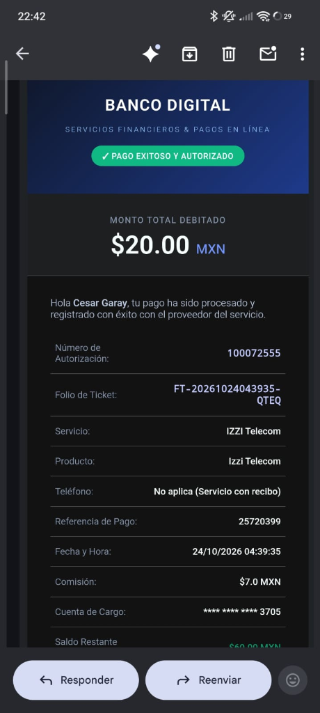
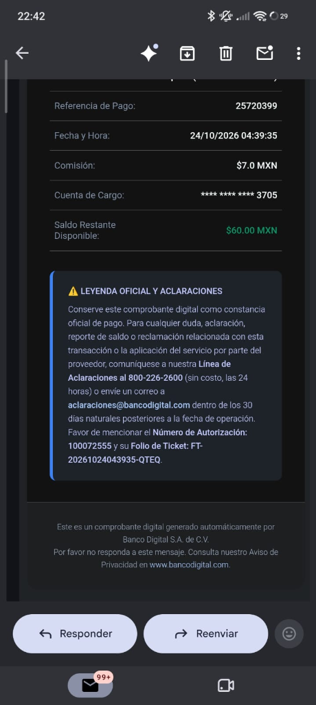
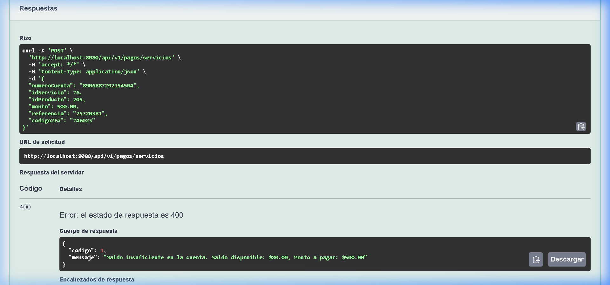
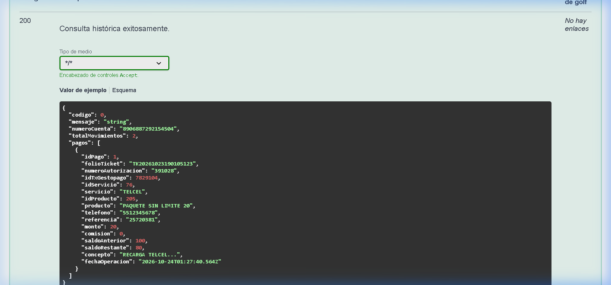

# 🏦 Sistema Bancario de Pago de Servicios & Recargas

API RESTful bancaria empresarial desarrollada con **Spring Boot 3**, **Java 21**, **PostgreSQL (Neon Cloud)** y desplegada en **Render**. Integra el módulo transaccional de pagos de servicios y tiempo aire con **GestoPago (PuntoRed)**, autenticación de dos factores (**2FA OTP**), cifrado **AES-256-CBC**, validación de saldos y emisión automática de comprobantes digitales vía **Brevo (Sendinblue)**.

---

## 🌐 Enlaces del Proyecto

* **API en Producción (Render Swagger UI):** [https://prueba-aplicaciones-web-progresivas.onrender.com/swagger-ui/index.html](https://prueba-aplicaciones-web-progresivas.onrender.com/swagger-ui/index.html)
* **Repositorio GitHub:** [https://github.com/cesargaray-dev/prueba_aplicaciones_web_progresivas](https://github.com/cesargaray-dev/prueba_aplicaciones_web_progresivas)
* **Rama de Producción:** `dev`
* **Rama de Desarrollo:** `feature/pago-servicios`

---

## 🚀 Características y Reglas de Negocio Implementadas

### 1. Pagos de Servicios y Recargas con GestoPago (`sendTx.do`)
* **Diferenciación de flujo (`tipoFront`):**
  * `tipoFront = 1` (Recargas de Tiempo Aire): Requiere número telefónico de 10 dígitos.
  * `tipoFront = 2` (Servicios con Recibo - CFE, Izzi, Telmex, etc.): Requiere número de referencia del recibo.
* **Cifrado AES-256-CBC:**
  * Generación de cadena alfanumérica aleatoria única de 10 caracteres (`random10`).
  * Encriptación simétrica AES-256 con padding PKCS5, vector de inicialización (`IV`) y clave secreta compartida con PuntoRed.
  * Codificación en Base64 para el parámetro `signed`.

### 2. Autenticación de Dos Factores (2FA OTP)
* **Generación de Códigos Temporales:** Genera un código numérico aleatorio de 6 dígitos mediante `POST /api/v1/pagos/2fa/generar`.
* **Vigencia:** 5 minutos (300 segundos). Soporta almacenamiento en memoria y en caché distribuida con **Redis**.
* **Protección contra Doble Uso (*Single-Use*):** El código 2FA se destruye e invalida inmediatamente tras el primer pago exitoso (`consumirCodigo2FA`), impidiendo cobros duplicados por reintento.

### 3. Regla Crítica de Deducción Segura del Dinero
* **Integridad Transaccional (`@Transactional`):** El saldo de la cuenta bancaria **ÚNICAMENTE se descuenta** si el proveedor GestoPago confirma la transacción con el código de éxito:
  $$\text{CODIGO} = \mathbf{01}$$
* Si el proveedor responde con cualquier otro código (ej. `02` Saldo insuficiente en bolsa, `06` Transacción duplicada, `82` Timeout):
  * **No se resta dinero de la cuenta.**
  * Se cancela la operación y se informa el motivo exacto devuelto por GestoPago.

### 4. Control Estricto de Saldo Insuficiente
* Antes de conectar con el proveedor externo, el sistema valida que el saldo disponible sea mayor o igual al monto a pagar:
  $$\text{Saldo Disponible} \ge \text{Monto a Pagar}$$
* Si la cuenta no tiene fondos suficientes, se rechaza de inmediato con `HTTP 400 Bad Request` indicando el saldo disponible y el monto solicitado.

### 5. Cuentas Bancarias de 16 Dígitos
* Estandarización a **16 dígitos numéricos** en la generación de cuentas (`ClienteServiceImpl`) y en todas las validaciones de entrada (`@Pattern(regexp = "^\\d{16}$")`).

### 6. Historial Cronológico de Pagos (`POST /api/v1/pagos/historial`)
* Permite auditar y consultar todas las transacciones realizadas por una cuenta bancaria, ordenadas cronológicamente de la más reciente a la más antigua con folio de ticket, autorización, servicio, montos y saldos restantes.

### 7. Emisión de Comprobantes Digitales con Brevo
* Notificación automática por correo electrónico al cliente titular en cuanto un pago resulta exitoso.
* Plantilla HTML bancaria responsive que cumple con los requerimientos solicitados:
  1. **Logotipo corporativo** institucional.
  2. **Número de Autorización** del proveedor.
  3. **Servicio y Producto** (ej. IZZI Telecom).
  4. **Teléfono** (si fue recarga).
  5. **Referencia de Pago** (si fue servicio con recibo).
  6. **Monto debitado y Comisión**.
  7. **Fecha y Hora** de la operación.
  8. **Leyenda oficial para aclaraciones** con números de contacto y plazos legales.

---

## 📸 Evidencias de Funcionamiento

### 1. Comprobante Digital Recibido por Correo (Brevo)

| Encabezado y Detalles del Pago | Leyenda Oficial de Aclaraciones |
| :---: | :---: |
|  |  |

> **Leyenda incluida en el correo:**
> *"Conserve este comprobante digital como constancia oficial de pago. Para cualquier duda, aclaración, reporte de saldo o reclamación relacionada con esta transacción o la aplicación del servicio por parte del proveedor, comuníquese a nuestra Línea de Aclaraciones al 800-226-2600 (sin costo, las 24 horas) o envíe un correo a aclaraciones@bancodigital.com dentro de los 30 días naturales posteriores a la fecha de operación. Favor de mencionar el Número de Autorización y su Folio de Ticket."*

---

### 2. Validación de Saldo Insuficiente (Swagger UI)

Cuando una cuenta con saldo menor al monto intenta realizar un pago, la solicitud es rechazada de inmediato y el dinero no se debita:



```json
{
  "codigo": 1,
  "mensaje": "Saldo insuficiente en la cuenta. Saldo disponible: $80.00, Monto a pagar: $500.00"
}
```

---

### 3. Consulta de Historial de Transacciones (Swagger UI)

El endpoint `POST /api/v1/pagos/historial` devuelve la lista cronológica completa de movimientos:



---

## 🧪 Cuentas de Prueba Disponibles para Evaluación

Las siguientes cuentas están activas y listas en la base de datos de producción:

| Número de Cuenta (16 dígitos) | Titular | Saldo Disponible | Correo de Notificación |
| :---: | :---: | :---: | :---: |
| `5225253189113705` | Cesar Enrique Garay Garcia | **$60.00 MXN** | `cesarenriquegaraygarcia@gmail.com` |
| `8906887292154504` | Carlos Sánchez | **$60.00 MXN** | `cesarenriquegaraygarcia50@gmail.com` |

---

## 🛠️ Guía Rápida de Prueba en Swagger

Para probar la API en [Render Swagger UI](https://prueba-aplicaciones-web-progresivas.onrender.com/swagger-ui/index.html):

### Paso 1: Generar código 2FA
* **Endpoint:** `POST /api/v1/pagos/2fa/generar`
* **Body:**
  ```json
  {
    "numeroCuenta": "5225253189113705"
  }
  ```
* Copia el `codigo2FA` devuelto (vigencia de 5 minutos).

### Paso 2: Realizar Pago de Servicio
* **Endpoint:** `POST /api/v1/pagos/servicios`
* **Body:**
  ```json
  {
    "numeroCuenta": "5225253189113705",
    "idServicio": 76,
    "idProducto": 205,
    "monto": 20.00,
    "referencia": "25720401",
    "codigo2FA": "TU_CODIGO_2FA_GENERADO"
  }
  ```
* **Respuesta esperada:** HTTP 200 OK con folio de ticket, número de autorización y saldo restante actualizado.
* El correo llegará inmediatamente a la bandeja asociada.

### Paso 3: Consultar Historial
* **Endpoint:** `POST /api/v1/pagos/historial`
* **Body:**
  ```json
  {
    "numeroCuenta": "5225253189113705"
  }
  ```

---

## 🛡️ Análisis de Arquitectura, Riesgos y Decisiones de Diseño (Integración GestoPago)

### 1. Validación de Catálogo y Prevención de Manipulación de Montos
* Antes de construir el payload transaccional, `PagoServicioServiceImpl#validarProductoYMontoEnCatalogo` consulta el catálogo oficial de GestoPago (`GestoPagoProductService`):
  * **Existencia de Producto y Servicio:** Verifica que el par `(idServicio, idProducto)` exista en el catálogo autorizado. Si no existe, rechaza la solicitud con `HTTP 400 Bad Request`.
  * **Anti-manipulación de precios:** Cuando el producto del catálogo tiene un precio fijo establecido (`precio > 0`, como en paquetes de recargas o pines), valida que el monto enviado coincida exactamente (`montoSolicitado.compareTo(precioCatalogo) == 0`). Para recibos de monto abierto (`precio == 0`), aplica validaciones estrictas de escala (máximo 2 decimales) y rango permitido (`$0.01` a `$50,000.00 MXN`).

### 2. Estrategia de Deducción de Saldo e Integridad Transaccional
* **Decisión de Diseño:** Se implementó una estrategia de **Verificación Previa con Bloqueo Pesimista + Deducción Atómica Post-Confirmación (`@Transactional`)**:
  1. Se adquiere un bloqueo exclusivo sobre la cuenta antes de invocar al proveedor y se verifica `saldo >= monto`.
  2. El cargo a la cuenta del cliente (`saldoRepository.save`) y el registro en `pagos_servicios` **solo se ejecutan cuando GestoPago confirma `CODIGO = 01`**.
  3. Si GestoPago devuelve un rechazo de negocio (`02`, `05`, `06`, `13`, etc.), se lanza `PagoServicioProveedorException` y la transacción hace rollback sin tocar el saldo del cliente.

### 3. Control de Concurrencia y Prevención de Cargos Duplicados
* **Doble Capa de Concurrencia:**
  1. **Nivel Aplicación (`ConcurrentHashMap<String, ReentrantLock>`):** `tryLock()` por número de cuenta rechaza de inmediato (`HTTP 409 Conflict`) peticiones simultáneas en vuelo para la misma cuenta.
  2. **Nivel Base de Datos (`@Lock(LockModeType.PESSIMISTIC_WRITE)`):** `CuentaRepository#findByNumeroCuentaForUpdate` ejecuta `SELECT ... FOR UPDATE` en PostgreSQL, serializando cualquier acceso concurrente al saldo.
* **Idempotencia en 3 Niveles:**
  1. **Consumo Atómico de 2FA:** El código OTP de 6 dígitos se consume e invalida inmediatamente tras autorizar la operación.
  2. **Ventana de Idempotencia Local (2 minutos):** Antes de llamar a `sendTx.do`, se verifica en `PagoServicioRepository` que no exista un pago exitoso reciente con la misma tupla `(numeroCuenta, idServicio, idProducto, referencia, telefono, monto)`.
  3. **Identificador Único de Transacción (`upc`):** Cada petición a GestoPago lleva un folio `upc` único para trazabilidad e idempotencia con el proveedor.

### 4. Manejo de Timeouts y Protocolo de Conciliación (`verifyTx.do`)
* **Regla Financiera Crítica:** *Un timeout de red o un código `82` del proveedor NO significa que la transacción no se haya procesado.* Reintentar ciegamente `sendTx.do` con un nuevo `upc` provocaría un **doble cobro**.
* **Mecanismo de Conciliación Implementado (`ejecutarYConciliarTransaccionGestoPago`):**
  * Cuando `sendTx.do` sufre un timeout (`FeignException.GatewayTimeout`, `RetryableException`) o responde `<CODIGO>82</CODIGO>`, el sistema **NO reintenta el cargo**.
  * En su lugar, invoca automáticamente el endpoint de consulta/conciliación `POST /sistema/service/verifyTx.do` enviando exactamente el mismo payload firmado (`signed` con el mismo `upc`).
  * Si `verifyTx.do` confirma que el proveedor sí aplicó el pago (`CODIGO = 01`), el sistema completa el descuento del saldo y emite el comprobante.
  * Si el estado permanece indeterminado, responde `HTTP 504 Gateway Timeout` entregando el folio `upc` de conciliación sin duplicar la operación.

### 5. Seguridad de Credenciales y Manejo Centralizado de Excepciones (`@RestControllerAdvice`)
* **Gestión Segura de Secretos:** El `Bearer Token`, `API Key`, `Secret Key AES`, `IV`, credenciales de BD y `BREVO_API_KEY` se inyectan mediante variables de entorno (`${GESTOPAGO_API_TOKEN:}`, `${GESTOPAGO_SECRET_KEY:}`, `${BREVO_API_KEY:}`), sin exponerse en código fuente, respuestas HTTP ni logs.
* **Sanitización de Logs:** Los números de cuenta se enmascaran (`************3705`) y nunca se registran tokens JWT ni tramas XML crudas con datos sensibles.
* **`GlobalExceptionHandler` (`@RestControllerAdvice`):** Centraliza todas las excepciones devolviendo códigos HTTP semánticos (`400`, `401`, `403`, `404`, `409`, `502`, `504`, `500`) bajo la estructura homologada `GenericResponse`.

---

## 📦 Stack Tecnológico

* **Lenguaje:** Java 21 (LTS)
* **Framework:** Spring Boot 3.3.6 (Web, Data JPA, OpenFeign, Validation)
* **Base de Datos:** PostgreSQL 16/18 en Neon Cloud
* **Migraciones:** Flyway Database Migrations
* **Caché:** Redis / Spring Data Redis
* **Integración Externa:** PuntoRed / GestoPago (`sendTx.do`) con Cifrado AES-256
* **Email Service:** Brevo REST API v3 (Sendinblue)
* **Documentación:** SpringDoc OpenAPI 3.0 / Swagger UI
* **Despliegue:** Render Cloud Platform
